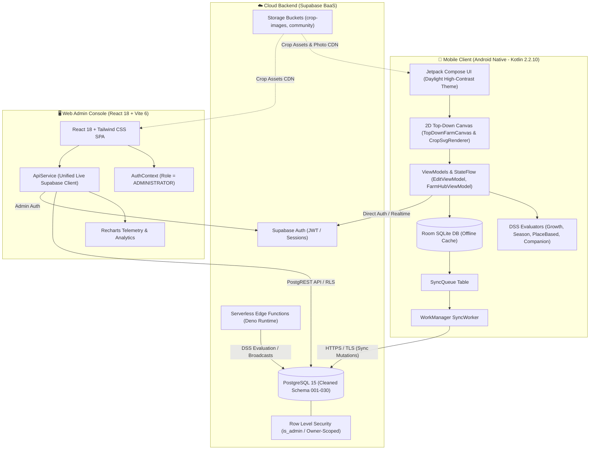

# 🌱 MapTanim

> **A Mobile-Based Interactive Farm Management and Agroecological Decision Support System (DSS) for Vegetable Farmers in the Philippines**

<div align="center">

-green?style=for-the-badge&logo=android)


-brightgreen?style=for-the-badge)


</div>

---

## 📖 Table of Contents

- [Executive Overview](#-executive-overview)
- [Academic Capstone Attribution](#-academic-capstone-attribution)
- [System Architecture](#-system-architecture)
- [📱 Tier 1: Mobile Application (Android)](#-tier-1-mobile-application-android)
  - [2D Top-Down Orthographic Garden Canvas](#2d-top-down-orthographic-garden-canvas)
  - [Direct-to-Soil Drag-and-Drop & Radial Action Ring](#direct-to-soil-drag-and-drop--radial-action-ring)
  - [8-Handle Interactive Resizing & Real-Life Spacing](#8-handle-interactive-resizing--real-life-spacing)
  - [Agroecological Decision Support System (DSS)](#agroecological-decision-support-system-dss)
  - [Offline-First Room SQLite & Sync Pipeline](#offline-first-room-sqlite--sync-pipeline)
  - [Farmer Community Hub & Attachment Pipeline](#farmer-community-hub--attachment-pipeline)
  - [Farm Hub, Calendar & Harvest Telemetry](#farm-hub-calendar--harvest-telemetry)
- [🖥️ Tier 2: Web Admin Dashboard (React + TypeScript)](#️-tier-2-web-admin-dashboard-react--typescript)
  - [Architecture & Tech Stack](#architecture--tech-stack)
  - [Administrative Features & Console Capabilities](#administrative-features--console-capabilities)
  - [Role-Based Access Control (RBAC)](#role-based-access-control-rbac)
- [🗄️ Tier 3: Supabase Cloud Backend & Database](#️-tier-3-supabase-cloud-backend--database)
  - [PostgreSQL Relational Schema (Cleaned v1.0)](#postgresql-relational-schema-cleaned-v10)
  - [Row Level Security (RLS) Hardening](#row-level-security-rls-hardening)
  - [Serverless Edge Functions](#serverless-edge-functions)
  - [Supabase Storage Buckets](#supabase-storage-buckets)
- [🥦 Canonical 13 Philippine Vegetable Catalog & Botanical Families](#-canonical-13-philippine-vegetable-catalog--botanical-families)
- [📂 Cleaned Repository Structure](#-cleaned-repository-structure)
- [🚀 Quick Start & Development Setup](#-quick-start--development-setup)
  - [Android Mobile App](#android-mobile-app)
  - [Web Admin Dashboard](#web-admin-dashboard)
  - [Supabase Database & Edge Functions](#supabase-database--edge-functions)
  - [Automated Multi-Platform Test Suite](#automated-multi-platform-test-suite)
- [📚 Master Documentation Index](#-master-documentation-index)

---

## 🌿 Executive Overview

**MapTanim** is an integrated agroecological farm management and decision support ecosystem engineered specifically for smallholder vegetable farmers, backyard gardeners, and urban growers in the Philippines.

Traditional digital agriculture tools often fail in rural and peri-urban Philippine farming communities due to their reliance on expensive connected IoT sensors, unstable internet, complicated form-heavy data entry, and generic agronomic recommendations detached from local Philippine crop varieties, pest profiles, and soil types.

MapTanim solves these challenges through three synchronized architectural tiers:
1. **Interactive 2D Top-Down Garden Canvas**: Completely replaces rigid form entry with a flat, orthographic 2D soil grid viewport. Farmers plant vegetables directly into rich loam soil, inspect plants with a tactile 6-action radial overlay ring, and resize crop zones using physical inch-, foot-, and yard-calibrated bounding boxes.
2. **Deterministic Agroecological DSS Engine**: Evaluates spatial companion compatibility ($d \le 3.0\text{m}$), 58 DA/BPI companion planting rules, and 5-stage phenological growth progression 100% deterministically from verified Philippine agricultural science — operating flawlessly offline with **zero IoT hardware and zero weather API dependency**.
3. **Synchronized Three-Tier Architecture**: Built around native Android Kotlin (offline-first Room SQLite with WorkManager background sync), a multi-tenant React 18 Admin Web Dashboard, and a hardened Supabase PostgreSQL cloud backend.

---

## 🎓 Academic Capstone Attribution

This project was conceived, designed, and developed as an undergraduate Capstone Project at:

* **Institution**: **STI West Negros University**
* **College**: College of Information and Communications Technology (CICT)
* **Program**: Bachelor of Science in Information Technology (BSIT)
* **Academic Year**: 2025–2026
* **Capstone Proponents**:
  - **Jomarey D. Parreño** — Project Manager
  - **John Ryan R. Vasquez** — System Analyst
  - **Jason B. Juanillo** — Lead Mobile Programmer
  - **James M. Cateo** — UI/UX Designer & Full-Stack Programmer
* **Capstone Adviser**: Ms. Danica S. Duazo
* **Capstone Coordinator**: Engr. Nahdem C. Columida, CpE
* **CICT Dean**: Mae B. Lodana, PhD TM

---

## 🏛️ System Architecture

MapTanim operates on a decoupled, offline-first client-server architecture:



---

## 📱 Tier 1: Mobile Application (Android)

* **Location**: [`mobile/app/`](mobile/app/)
* **Stack**: Kotlin 2.2.10, Jetpack Compose, Compose Canvas, Room SQLite, WorkManager, Coil, Supabase Kotlin BOM 3.6.0.
* **Target OS**: Android 10+ (API 29 to 34).

### 2D Top-Down Orthographic Garden Canvas
The rendering engine ([`TopDownFarmCanvas.kt`](mobile/app/src/main/java/com/maptanim/app/features/farm/renderer/canvas/TopDownFarmCanvas.kt)) is built purely in **2D top-down flat orthographic projection**:
- **Orthographic Coordinate Mapping**: [`TopDownProjection`](mobile/app/src/main/java/com/maptanim/app/features/farm/renderer/canvas/TopDownFarmCanvas.kt#L68-L103) maps world meter coordinates $(x, y)$ directly to screen pixel offsets:
  $$\text{screenX} = \text{worldX} \times \text{PPM} \times \text{zoom} + \text{panX}$$
  $$\text{screenY} = \text{worldY} \times \text{PPM} \times \text{zoom} + \text{panY}$$
  Where $\text{PPM} = 40.0\text{ px/meter}$.
- **Top-Down Yard Rulers**: Displays metric yard, feet, and inch measurements along the top and left borders, with dynamic number ticks reflecting real dimensions (e.g. $10\text{ ft} \times 8\text{ ft}$).
- **Rich Loam Soil Surface**: Centered dark brown loam soil grid (`#261814`) with clean white grid lines and high-contrast bounding boxes.
- **Zero-Pixelation Vector SVG Rendering**: [`CropSvgRenderer.kt`](mobile/app/src/main/java/com/maptanim/app/features/farm/renderer/canvas/CropSvgRenderer.kt) draws crisp, scalable 2D top-down vector illustrations directly into Compose `DrawScope` with zero raster degradation at any zoom level.

### Direct-to-Soil Drag-and-Drop & Radial Action Ring
- **Direct Soil Planting**: No abstract container hierarchies or physical raised-bed objects required. Tapping the bottom-right `[+] ADD VEGETABLES` button opens [`VegetableSelectionOverlay.kt`](mobile/app/src/main/java/com/maptanim/app/features/farm/components/VegetableSelectionOverlay.kt). Farmers drag a vegetable card and drop it directly onto the top-down soil grid.
- **Focus Dimming**: Tapping an existing planted crop applies a soft background tint over the canvas and locks viewport panning to focus interaction on the selected plant.
- **6-Action Radial Floating Ring**: [`CropCircleActionOverlay.kt`](mobile/app/src/main/java/com/maptanim/app/features/farm/components/CropCircleActionOverlay.kt) animates a tactile circular action ring with a spring bounce, positioning 6 key tools symmetrically around the vegetable at clock hours:
  - 🕛 **12:00 — See Info** (`Icons.Default.Info`): Opens detailed botanical, varietal, and cultural care dossier.
  - 🕑 **2:00 — Check Up** (`Icons.Default.MedicalServices`): Launches the DSS symptom checker & diagnostic health examination.
  - 🕓 **4:00 — Calendar** (`Icons.Default.CalendarMonth`): Opens planting date configuration, growth stage progress, and harvest window calculator.
  - 🕕 **6:00 — Resize** (`Icons.Default.AspectRatio`): Activates the interactive 8-handle bounding box and quick resize bar (- / + in inches/feet).
  - 🕗 **8:00 — Copy** (`Icons.Default.ContentCopy`): Duplicates the crop zone to an adjacent grid position.
  - 🕙 **10:00 — Delete** (`Icons.Default.DeleteOutline`): Prompts a confirmation dialog to safely remove the crop zone.
  - 🔘 **Center**: High-resolution vegetable hero avatar and crop name badge.

### 8-Handle Interactive Resizing & Real-Life Spacing
- **8 Touch Handles**: Corner handles (`TOP_LEFT`, `TOP_RIGHT`, `BOTTOM_LEFT`, `BOTTOM_RIGHT`) and edge midpoints (`TOP`, `BOTTOM`, `LEFT`, `RIGHT`) allow farmers to resize crop zones to exact yard measurements.
- **Grid Snapping**: Automatically snaps to 6-inch increments ($0.1524\text{m}$) or 1-foot increments ($0.3048\text{m}$).
- **Real-Life Canopy & Spacing Calibration** ([`RenderModels.kt`](mobile/app/src/main/java/com/maptanim/app/features/farm/renderer/model/RenderModels.kt#L173-L252)):
  - *Carrot / Radish*: 1 inch diameter ($0.0254\text{m}$), 3-inch spacing
  - *Green Onion / Scallion*: 3 inches diameter ($0.0762\text{m}$), 3-inch spacing
  - *Pechay / Bok Choy*: 6 inches diameter ($0.1524\text{m}$), 6-inch spacing
  - *Lettuce*: 8 inches diameter ($0.2032\text{m}$), 8-inch spacing
  - *Yardlong String Beans / Potato*: 12 inches / 1 ft ($0.3048\text{m}$), 12-inch spacing
  - *Cabbage*: 15 inches diameter ($0.381\text{m}$), 15-inch spacing
  - *Tomato / Eggplant / Cucumber / Bitter Gourd / Bell Pepper*: 18 inches / 1.5 ft ($0.4572\text{m}$), 18-inch spacing
  - *Squash / Kalabasa*: 36 inches / 1 yard ($0.9144\text{m}$), 36-inch spacing
- Expanding a crop zone automatically tiles duplicate plant instances with authentic agronomic spacing without stretching vegetable sprites.

### Agroecological Decision Support System (DSS)
- **Zero IoT & Zero Weather Dependency**: Operates deterministically from field-tested Philippine agronomic rules (Bureau of Plant Industry & Department of Agriculture).
- **Spatial Companion Engine (58 Rules)**: Analyzes Euclidean proximity ($d \le 3.0\text{m}$) between all placed vegetables on the top-down canvas:
  - **Beneficial Pairings**: e.g., Tomato + Basil/Lettuce (pest repellent & soil moisture conservation), Eggplant + String Beans (nitrogen fixation).
  - **Antagonistic Pairings**: e.g., Tomato + Eggplant (shared fungal blight risks & heavy nitrogen depletion), Tomato + Corn (attracts corn earworm/fruitworm).
- **5-Stage Phenological Growth Progression**:
  1. *Sprout (0–15%)*: Sowing depth, moisture retention, nursery germination.
  2. *Seedling (15–35%)*: Hardening off, gentle bottom-watering, thinning.
  3. *Vegetative (35–65%)*: Nitrogen scheduling, weeding, bamboo trellising.
  4. *Flowering & Fruit Set (65–90%)*: Potassium/Phosphorus amendments, blossom rot prevention.
  5. *Harvest (90%+)*: Maturity indicators, pick-vs-pull harvesting techniques.
- **₱0 Household Remedy Symptom Checker**: Multi-question diagnostic decision trees for common pests (Cutworms, Aphids, Fruit Borers) and deficiencies with zero-budget household solutions (wood ash, chili-garlic-soap spray, crushed eggshell calcium tea).

### Offline-First Room SQLite & Sync Pipeline
- **Immediate Local Writes**: All farm creations, garden resizing, vegetable placements, task completions, and harvest entries write to **Room SQLite** instantly.
- **SyncQueue Pattern**: Every mutation inserts a queued operation (`INSERT`, `UPDATE`, `DELETE`) with timestamp and serialized JSON payload into `sync_queue`.
- **Background `SyncWorker`**: An Android `WorkManager` periodic and immediate worker drains `sync_queue` in chronological order with exponential backoff on network availability.

### Farmer Community Hub & Attachment Pipeline
- **Community Forum**: High-performance photo-sharing feed with post titles, descriptions, like reactions, and threaded comments.
- **Multi-Scheme Image Resolver**: Safely handles camera and gallery URIs across `file://`, `content://`, `http://`, and `https://` protocols with bounded-height letterboxing and full-screen image dialogs.
- **Abuse Moderation**: Built-in reporting dialog allowing farmers to flag inappropriate posts directly into the admin moderation queue.

### Farm Hub, Calendar & Harvest Telemetry
- **FarmHubScreen**: Multi-garden management dashboard listing gardens with dimensions (e.g. $10\text{ ft} \times 8\text{ ft}$), archive toggle, and `+ NEW GARDEN` modal with scrollable dimension selectors.
- **Planting Calendar**: Stage progression tabs, simulation day calculations from planting date, and projected harvest windows.
- **Harvest Tracker**: Logs historical yields (kg), crop quality ratings, and auto-calculates cumulative farm harvest stats.

---

## 🖥️ Tier 2: Web Admin Dashboard (React + TypeScript)

* **Location**: [`admin/`](admin/)
* **Stack**: React 18, TypeScript 5.7, Vite 6, Tailwind CSS 4, Lucide React, Recharts.
* **Role**: Centralized administrative web console for agronomists, extension workers, and platform operators.

### Architecture & Tech Stack
- Single Page Application (SPA) containerized via Docker and Nginx.
- Communicates directly with Supabase via `@supabase/supabase-js` using standard PostgREST queries governed by database Row Level Security.
- Zero mock dependencies: Live Supabase PostgreSQL integration through [`admin/src/services/api.ts`](admin/src/services/api.ts).

### Administrative Features & Console Capabilities
1. **Dashboard Overview**:
   - Live KPI Stat Cards: Total Registered Farmers, Active Farms, Total Crop Plots, Monthly Harvest Yield (kg), Platform CSAT.
   - Dynamic Recharts Visualizations: Crop Distribution Pie Charts, 6-Month Harvest Yield Bar Charts, 30-Day Farmer Registration trends.
2. **Farmer Directory & User Management**:
   - Complete registry of farmers with active plots count, account status (`ACTIVE`, `SUSPENDED`), and registration dates.
   - Administrative actions: Update user status, reassign user roles, view farm details.
3. **Community Hub Moderation**:
   - Real-time review of farmer posts and comments.
   - Moderation panel for reviewing flagged posts reported by community members with instant one-click deletion.
4. **Customer Service & Support Ticket Center**:
   - Live support chat and ticket triage system.
   - CSAT rating analytics, SLA resolution times, and ticket category breakdown.
5. **Crop Catalog & Agronomic Rules Hub**:
   - View, create, edit, and delete canonical Philippine vegetable varieties and companion planting rules.
   - Synchronize official metadata and crop photographic assets to Supabase Storage.
6. **System Audit Logs**:
   - Immutable security trail logging all administrative mutations (crop edits, user suspensions, post removals) to `admin_audit_logs`.

### Role-Based Access Control (RBAC)
- Authenticates through official Supabase Auth (`signInWithPassword`).
- Enforces role verification requiring `role = 'ADMINISTRATOR'` and `status = 'ACTIVE'` in `public.users`.
- Backend PostgreSQL RLS policies verify credentials via `is_admin()` security definer function before returning administrative datasets.

---

## 🗄️ Tier 3: Supabase Cloud Backend & Database

* **Location**: [`database/migration/`](database/migration/) & [`supabase/migrations/`](supabase/migrations/)
* **Live Project**: `https://ojilvcglpzbtpjxguhzj.supabase.co`
* **Migrations**: 001 through 030 (Cleaned and aligned).

### PostgreSQL Relational Schema (Cleaned v1.0)
Legacy redundant tables (`farm_tiles`, `farm_objects`, `tile_plantings`, `planting_monitors`, `crop_profiles`) have been permanently purged via Migration 020 to eliminate database bloat and optimize mobile bandwidth. Scenery and grid tiles are rendered procedurally on the client.

#### Core Relational Tables
| Table | Description | Primary Key | Foreign Keys / Relations |
|---|---|---|---|
| `users` | User identity & platform roles (`FARMER`, `ADMINISTRATOR`, `GUEST`) | `id` (UUID) | Matches `auth.users(id)` |
| `profiles` | Extended profile metadata (nickname, avatar, tutorial status) | `id` (UUID) | `id → auth.users.id` |
| `farms` | Farm entities with metric yard dimensions (`yard_width_m`, `yard_length_m`) | `id` (TEXT) | `farmer_id → users.id` |
| `crop_plots` | Direct-soil planting plots (`pos_x`, `pos_y`, `width_m`, `height_m`, `soil_type`) | `id` (TEXT) | `farm_id → farms.id` |
| `crop_zones` | Sub-regions organizing individual plant instances within plots | `id` (TEXT) | `plot_id → crop_plots.id` |
| `crops` | Canonical 15 Philippine vegetable reference data & agronomic constants | `id` (UUID) | Admin-managed catalog |
| `dss_rules` | 58 bi-directional companion planting rules (`BENEFICIAL`, `ANTAGONIST`) | `id` (UUID) | `crop_a_id, crop_b_id → crops.id` |
| `tasks` | Daily actionable tasks (`WATER`, `FERTILIZE`, `HARVEST`, `PEST_ALERT`) | `id` (TEXT) | `plot_id → crop_plots.id`, `farm_id → farms.id` |
| `harvest_records`| Historical yield logs (`yield_kg`, `harvest_date`, `quality_rating`) | `id` (TEXT) | `plot_id → crop_plots.id` |
| `community_posts`| Farmer community forum posts with image attachments and like counts | `id` (TEXT) | `user_id → users.id` |
| `community_comments`| Threaded discussion comments on community posts | `id` (TEXT) | `post_id → community_posts.id`, `user_id → users.id` |
| `community_reports`| Flagged abuse reports on posts for admin moderation | `id` (TEXT) | `post_id → community_posts.id`, `reporter_id → users.id` |
| `feedback` | User customer service inquiries, bug reports, and CSAT scores | `id` (TEXT) | `user_id → users.id` |
| `notifications` | In-app alerts, task reminders, and emergency broadcast advisories | `id` (TEXT) | `user_id → users.id` |
| `admin_audit_logs`| Tamper-proof audit logs for admin actions (INSERT/SELECT only) | `id` (TEXT) | `admin_id → users.id` |

### Row Level Security (RLS) Hardening
- **Owner-Scoped Policies**: All farmer data tables (`farms`, `crop_plots`, `crop_zones`, `tasks`, `harvest_records`, `feedback`) enforce `auth.uid() = farmer_id` or `auth.uid() = user_id`.
- **Admin Privilege Definer**:
  ```sql
  CREATE OR REPLACE FUNCTION public.is_admin()
  RETURNS BOOLEAN AS $$
  BEGIN
    RETURN EXISTS (
      SELECT 1 FROM public.users
      WHERE id = auth.uid()
        AND role = 'ADMINISTRATOR'
        AND status = 'ACTIVE'
    );
  END;
  $$ LANGUAGE plpgsql SECURITY DEFINER;
  ```
- **Admin Read/Write Policies**: Table policies permit full read access to administrators across all operational tables for dashboard telemetry and platform moderation.

### Serverless Edge Functions
Located in [`backend/supabase/functions/`](backend/supabase/functions/) (Deno TypeScript runtime):
- **`evaluate-dss`**: Evaluates farm spatial layout, Euclidean crop distance ($d \le 3.0\text{m}$), 58 companion rules, and phenological stage progression, dispatching dynamic care tasks into `public.tasks`.
- **`broadcast-dispatcher`**: Admin dispatch service broadcasting urgent pest infestation warnings and seasonal advisories across user notification queues.
- **`sync-profile`**: Handles user creation, role assignment, and metadata synchronization upon Supabase Auth registration.

### Supabase Storage Buckets
- `crop-images`: Public CDN hosting high-resolution vegetable sprites, botanical illustrations, and phenological stage photographs.
- `community-images`: Public bucket storing farmer photo uploads from the mobile Community Hub.
- `avatars`: User profile avatar graphics.

---

## 🥦 Canonical 13 Philippine Vegetable Catalog & Botanical Families

MapTanim groups the 13 canonical Philippine vegetable crops into **7 Botanical Families** ([`VegetableSelectionOverlay.kt`](mobile/app/src/main/java/com/maptanim/app/features/farm/components/VegetableSelectionOverlay.kt#L102-L140)) to guide crop rotation and prevent soil-borne pathogen accumulation:

| Botanical Family | Icon | Crops Included | Local Names | Maturity (Days) | Ideal Soil | Companion Planting Highlights |
|---|---|---|---|---|---|---|
| **Solanaceae** *(Nightshade)* | 🍅 | Tomato, Eggplant, Bell Pepper, Potato | Kamatis, Talong, Siling Atsal, Patatas | 75–110 | Loam / Sandy Loam | **Beneficial**: Basil, Beans, Carrot • **Antagonist**: Corn, Fennel |
| **Cucurbitaceae** *(Gourd)* | 🥒 | Squash, Cucumber, Bitter Gourd | Kalabasa, Pipino, Ampalaya | 50–100 | Loam / Sandy Loam | **Beneficial**: Corn, Legumes, Radish • **Antagonist**: Potato, Aromatic Herbs |
| **Brassicaceae** *(Cabbage/Mustard)* | 🥬 | Cabbage, Pechay | Repolyo, Pechay / Bok Choy | 30–90 | Loam | **Beneficial**: Mint, Celery, Onion • **Antagonist**: Tomato, Strawberry |
| **Fabaceae** *(Legume)* | 🫘 | String Beans / Yardlong Bean | Sitaw | 55–65 | Loam / Clay | **Beneficial**: Corn, Eggplant, Cucumber • **Antagonist**: Onion, Garlic |
| **Amaryllidaceae** *(Allium)* | 🧅 | Green Onion / Scallion | Sibuyas Dahon | 60–70 | Sandy Loam | **Beneficial**: Carrot, Cabbage, Tomato • **Antagonist**: Beans, Peas |
| **Apiaceae** *(Carrot)* | 🥕 | Carrot | Karot | 70–80 | Deep Sandy Loam | **Beneficial**: Lettuce, Tomato, Rosemary • **Antagonist**: Dill, Fennel |
| **Asteraceae** *(Daisy/Aster)* | 🥗 | Lettuce | Litsugas | 40–50 | Sandy Loam | **Beneficial**: Carrot, Radish, Strawberry • **Antagonist**: Celery, Parsley |

---

## 📂 Cleaned Repository Structure

```
MapTanim/
├── .github/
│   └── workflows/              # GitHub Actions CI/CD (Android, Admin, DevOps)
├── admin/                      # React 18 + Vite 6 + TypeScript 5.7 Admin Dashboard
│   ├── public/                 # Static assets & crop metadata images
│   ├── src/
│   │   ├── components/         # Layout (Header, Sidebar), Common (Modal, Badge), Charts
│   │   ├── context/            # AuthContext (real Supabase RBAC), ThemeContext
│   │   ├── pages/              # Dashboard, Farmers, Community, Feedback, SystemLogs
│   │   ├── services/           # api.ts (Unified Live Supabase Service), supabase.ts
│   │   └── types/              # TypeScript interface definitions & Supabase DB types
│   ├── package.json
│   └── vite.config.ts
├── backend/                    # Backend Android Library Module & Supabase Functions
│   ├── src/main/java/          # com.maptanim.backend (AuthRepository, SupabaseClient)
│   ├── supabase/functions/     # Edge Microservices (evaluate-dss, broadcast-dispatcher)
│   └── build.gradle.kts
├── database/                   # Supabase Database Migrations & Reference SQL
│   ├── migration/              # 001 to 030 Versioned SQL Migrations
│   ├── seed/                   # Master crop knowledge seeds
│   └── sql/                    # Baseline schemas
├── deployment/                 # Docker, Nginx, Environment templates & test runners
│   ├── Dockerfile.admin        # Production multi-stage Nginx build for Admin Web
│   ├── docker-compose.yml      # Service container orchestration
│   ├── nginx.conf              # SPA Nginx configuration with Gzip & security headers
│   └── scripts/                # bootstrap-env and run-all-tests runners
├── docs/                       # Comprehensive Technical Documentation Suite
│   ├── 00_GETTING_STARTED.md   # Setup prerequisites & smoke tests
│   ├── 03_SYSTEM_ARCHITECTURE.md
│   ├── 04_ANDROID_ARCHITECTURE.md
│   ├── 07_DATABASE_DESIGN.md
│   ├── 20_DECISION_SUPPORT_SYSTEM.md
│   ├── 24_OFFLINE_SYNCHRONIZATION.md
│   └── README.md               # Master Documentation Hub Index
├── mobile/                     # Native Android Kotlin Jetpack Compose Application
│   └── app/
│       ├── src/main/
│       │   ├── assets/         # Crop SVG vector assets & official JSON metadata
│       │   ├── java/com/maptanim/app/
│       │   │   ├── core/       # Logging & Application Singletons
│       │   │   ├── data/       # Room Database, DAOs, Entities, Repositories, SyncWorker
│       │   │   ├── domain/     # Clean Architecture Domain Models & Use Cases
│       │   │   ├── dss/        # Agroecological Decision Support Evaluators
│       │   │   ├── features/   # Auth, Home, Farm (Canvas & Tray), Community, Profile
│       │   │   │   └── farm/
│       │   │   │       ├── canvas/    # FarmCanvasView & FarmLayoutPreviewCanvas
│       │   │   │       ├── components/# CropCircleActionOverlay & VegetableSelectionOverlay
│       │   │   │       └── renderer/  # TopDownFarmCanvas, CropSvgRenderer, RenderModels
│       │   │   ├── navigation/ # Jetpack Compose Navigation Graph
│       │   │   └── ui/         # Theme tokens, Daylight High-Contrast Palette
│       │   └── res/            # Drawables, mipmaps, strings, colors, themes
│       └── build.gradle.kts
├── supabase/                   # Supabase CLI Project Configuration
│   ├── config.toml             # Local Supabase dev config
│   └── migrations/             # Timestamped Supabase CLI migrations
├── tests/                      # Automated Verification & Integration Test Suite
│   ├── integration/            # api_integration_test.py (Database & API payload contracts)
│   ├── performance/            # load_simulation_test.py (Latency & telemetry benchmarks)
│   ├── ui/                     # admin_e2e_test.mjs (Admin UI contracts & service verification)
│   └── unit/                   # dss_matrix_test.py (2D grid math & companion planting logic)
├── build.gradle.kts            # Root Gradle project configuration
├── settings.gradle.kts         # Gradle module inclusions (:mobile:app, :backend)
└── README.md                   # Master Project Documentation & Specification
```

---

## 🚀 Quick Start & Development Setup

### Prerequisites
- **Java Development Kit (JDK)**: OpenJDK 17 or higher
- **Android Studio**: Ladybug / Meerkat (2024.2+) with Android SDK 34/37
- **Node.js**: v18.0+ or v20.0+ with npm / npx
- **Python**: 3.10+ (for integration test suites)
- **Supabase CLI**: Optional, for local database migrations

---

### Android Mobile App

1. Open Android Studio and select **Open** → choose the repository root folder (`MapTanim/`).
2. Allow Gradle sync to complete automatically.
3. Configure your local signing and Firebase variables in `mobile/app/local.properties` (or use defaults).
4. Build the debug APK via Gradle:
   ```bash
   # Windows (PowerShell)
   .\gradlew.bat assembleDebug

   # Linux / macOS
   ./gradlew assembleDebug
   ```
5. Deploy to an Android emulator or connected device via Android Studio Run (`Shift + F10`).

---

### Web Admin Dashboard

1. Navigate to the admin web directory:
   ```bash
   cd admin
   ```
2. Install frontend dependencies:
   ```bash
   npm install
   ```
3. Start the Vite local development server:
   ```bash
   npm run dev
   ```
   Open [http://localhost:5173](http://localhost:5173) in your browser.

4. To build for production:
   ```bash
   npm run build
   ```

---

### Supabase Database & Edge Functions

1. Link to the MapTanim Supabase cloud project:
   ```bash
   npx supabase link --project-ref ojilvcglpzbtpjxguhzj
   ```
2. Apply database migrations:
   ```bash
   npx supabase db push
   ```
3. Deploy Edge Functions:
   ```bash
   npx supabase functions deploy evaluate-dss
   npx supabase functions deploy broadcast-dispatcher
   npx supabase functions deploy sync-profile
   ```

---

### Automated Multi-Platform Test Suite

MapTanim includes an automated test runner executing verification across all platform tiers:

**Windows (PowerShell):**
```powershell
.\deployment\scripts\run-all-tests.ps1
```

**Linux / macOS (Bash):**
```bash
./deployment/scripts/run-all-tests.sh
```

**Individual Test Suites:**
- **Admin TypeScript & E2E**: `node tests/ui/admin_e2e_test.mjs`
- **Database & API Integration**: `py tests/integration/api_integration_test.py`
- **DSS Matrix & Grid Bounds**: `py tests/unit/dss_matrix_test.py`
- **Performance & Telemetry**: `py tests/performance/load_simulation_test.py`
- **Mobile Android Unit Tests**: `.\gradlew.bat testDebugUnitTest`

---

## 📚 Master Documentation Index

Comprehensive technical documentation is maintained in the [`docs/`](docs/) directory and indexed in the [Master Documentation Hub](docs/README.md):

| Category | Chapter | Title & Link |
|---|---|---|
| **Overview** | **00** | [Getting Started & Setup Guide](docs/00_GETTING_STARTED.md) |
| | **01** | [Project Overview & Capstone Goals](docs/01_PROJECT_OVERVIEW.md) |
| | **02** | [Software Requirements Specification (SRS)](docs/02_SOFTWARE_REQUIREMENTS_SPECIFICATION.md) |
| **Architecture** | **03** | [System Architecture & Data Flow](docs/03_SYSTEM_ARCHITECTURE.md) |
| | **04** | [Android Native App Architecture](docs/04_ANDROID_ARCHITECTURE.md) |
| | **05** | [Backend Services & Supabase Architecture](docs/05_BACKEND_ARCHITECTURE.md) |
| | **06** | [Admin Web Dashboard Specifications](docs/06_ADMIN_DASHBOARD.md) |
| **Database** | **07** | [Primary Database Design & SQL Schema](docs/07_DATABASE_DESIGN.md) |
| | **08** | [Supabase Project Configuration](docs/08_SUPABASE_CONFIGURATION.md) |
| | **09** | [Authentication & Session Management](docs/09_AUTHENTICATION.md) |
| | **25** | [Row-Level Security (RLS) & Data Protection](docs/25_SECURITY.md) |
| **UI & Render Engine** | **11** | [Android Navigation Graph](docs/11_NAVIGATION.md) |
| | **13** | [Theme & Design System Tokens](docs/13_DESIGN_SYSTEM.md) |
| | **16** | [Interactive Plot Mapping System](docs/16_INTERACTIVE_PLOT_MAPPING.md) |
| | **19** | [Edit Mode & Layout Tooling](docs/19_EDIT_MODE.md) |
| | **34** | [Direct Soil Crop Planting & 8-Handle Resizing](docs/34_CROP_PLANTING_AND_RESIZE_SYSTEM.md) |
| **Decision Support** | **20** | [Agroecological Decision Support System (DSS)](docs/20_DECISION_SUPPORT_SYSTEM.md) |
| | **21** | [Philippine Vegetable Knowledge Base](docs/21_KNOWLEDGE_BASE.md) |
| | **22** | [Planting Calendar Engine](docs/22_CALENDAR.md) |
| | **43** | [Beginner Backyard DSS Implementation](docs/43_BEGINNER_BACKYARD_DSS_IMPLEMENTATION.md) |
| **Sync & Ops** | **24** | [Offline-First Sync Architecture (Room + WorkManager)](docs/24_OFFLINE_SYNCHRONIZATION.md) |
| | **26** | [Automated Testing Strategy](docs/26_TESTING.md) |
| | **27** | [Deployment & Release Operations](docs/27_DEPLOYMENT.md) |
| | **Ops** | [DevOps Pipelines & CI/CD (`DEVOPS.md`)](docs/DEVOPS.md) |

---

<div align="center">

**MapTanim** — Empowering Smallholder Vegetable Farmers with Intuitive Digital Tools & Grounded Science.  
*College of Information and Communications Technology • STI West Negros University (2026)*

</div>
